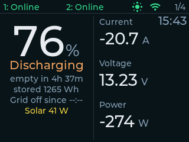
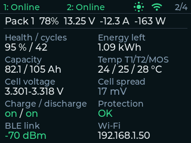
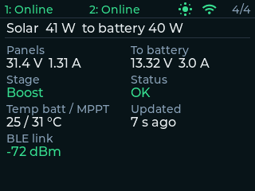

<div align="center">



# cyd-jk-bms

[](https://github.com/vplikin/cyd-jk-bms/actions/workflows/ci.yml)
[](https://platformio.org/)
[](#hardware)
[](https://lvgl.io/)
[](LICENSE)

Standalone JK BMS monitor for the ESP32 "Cheap Yellow Display": battery state, grid outages and solar charging at a glance, with no phone app or cloud.

[Features](#features) • [Hardware](#hardware) • [Getting started](#getting-started) • [Configuration](#configuration) • [Using the display](#using-the-display) • [Network API](#network-api)

</div>

## Features

- **One or two JK BMS** packs in parallel over Bluetooth LE, combined into a single bank view: capacity-weighted SOC, total current and power, time to full or empty.
- **Per-pack details**: SOH, cycles, cell voltages and spread, temperatures, MOSFET state, protections, BLE signal.
- **Grid outage tracking**: shows how long the power has been out, or when it came back, and keeps it across reboots.
- **Warnings that matter**: BMS protections, lost link, cell imbalance, high or low temperature, MOSFETs off. Current turns yellow or red past your thresholds.
- **Optional EPEVER MPPT** solar charge controller via its BLE gateway: PV and battery power, charge stage, temperatures.
- **Pixel-art screensaver** with seasonal day and night scenes and live weather effects (rain, snow, fog, storm) from Open-Meteo.
- **JSON over HTTP and UDP broadcast** for logging, Home Assistant or your own collector.
- **English or Russian UI**, selected at build time.

<table>
  <tr>
    <td align="center"><br><sub>Pack details</sub></td>
    <td align="center"><br><sub>Solar charge controller</sub></td>
    <td align="center"><br><sub>Screensaver</sub></td>
  </tr>
</table>

## Hardware

| Part | Notes |
| --- | --- |
| [ESP32-2432S028R](https://github.com/witnessmenow/ESP32-Cheap-Yellow-Display) ("CYD") | 320x240 ILI9341 TFT with XPT2046 resistive touch, stock wiring |
| JK BMS with Bluetooth | Smart BMS protocol. Newer units use the 32S frame layout; set `JK_PROTOCOL_32S 0` for older 24S units |
| EPEVER controller + EPEVER BLE module *(optional)* | Advertises as `HN_*`, speaks Modbus RTU over BLE |

No wiring is needed: the display talks to everything over Bluetooth and runs from any USB power supply. Wi-Fi is optional. Without it you lose the clock, the screensaver, weather and the network API.

## Getting started

You need [PlatformIO](https://platformio.org/install). Dependencies are pinned in [`platformio.ini`](platformio.ini) and fetched on the first build: Arduino core 2.x, LVGL 8.4, NimBLE-Arduino 1.4, TFT_eSPI.

1. Clone the repository and create your local config:

   ```bash
   git clone https://github.com/vplikin/cyd-jk-bms.git
   cd cyd-jk-bms
   cp include/secrets.example.h include/secrets.h
   ```

2. Edit `include/secrets.h`: Wi-Fi, number of packs, time zone (see [Configuration](#configuration)).

3. Build, flash and watch the log:

   ```bash
   pio run -e cyd -t upload
   pio device monitor -b 115200
   ```

> [!IMPORTANT]
> Close the JK BMS and Solar Guardian phone apps, or any other software that holds the Bluetooth connection, before the display connects. Each device accepts only one BLE client at a time.

> [!TIP]
> MAC addresses are optional. If you leave them empty, the display connects to the first free `JK_*` device it finds and prints its address in the serial log (`JK1: found ...`). Pinning the MAC in `secrets.h` is only needed when several BMS are in range.

## Configuration

Local settings go into `include/secrets.h`. The file is git-ignored and included before [`include/config.h`](include/config.h), so any `#define` in it overrides the default.

| Define | Default | Meaning |
| --- | --- | --- |
| `WIFI_SSID`, `WIFI_PASS` | `""` | Wi-Fi network. An empty SSID disables Wi-Fi |
| `WIFI_HOSTNAME` | `cyd-jk-bms` | mDNS name, reachable as `http://cyd-jk-bms.local` |
| `JK_BMS_COUNT` | `1` | Number of packs, `1` or `2` |
| `JK_BMS_MAC_1`, `JK_BMS_MAC_2` | `""` | BMS MAC addresses. `""` scans for the first free `JK_*` device |
| `MPPT_MAC` | `""` | EPEVER gateway MAC. `""` disables the MPPT client and hides its page |
| `TZ_INFO` | `UTC0` | [POSIX time zone](https://github.com/nayarsystems/posix_tz_db/blob/master/zones.csv) for the clock, e.g. `CET-1CEST,M3.5.0,M10.5.0/3` |
| `WEATHER_LAT`, `WEATHER_LON` | `""` | Location for the screensaver weather. `""` disables it |
| `UI_LANG` | `UI_LANG_EN` | Display language: `UI_LANG_EN` or `UI_LANG_RU` |

Everything else is documented inline in [`config.h`](include/config.h): fallback pack capacity, polling intervals, current, cell spread and temperature thresholds, screen sleep, screensaver hours and per-season scene times.

> [!WARNING]
> The current thresholds (`PACK_CUR_WARN_A`, `PACK_CUR_BAD_A`) default to 50 A and 80 A per pack. Set them to match your BMS, cabling and inverter.

## Using the display

The status bar on every page shows the link state of each BMS, the MPPT (sun icon), Wi-Fi and the page number.

| Page | Content |
| --- | --- |
| **Main** | Bank SOC, charge or discharge with ETA, current, voltage, power, grid state, warning line |
| **Pack 1, Pack 2** | SOH, cycles, capacity, temperatures, cell voltages and spread, MOSFETs, protections, BLE RSSI |
| **MPPT** | PV and battery-side power, charge stage, controller state, temperatures, BLE link |

- **Tap** anywhere for the next page. After 30 s without touches the main page comes back.
- After `UI_SLEEP_MS` the backlight dims. During the screensaver hours the display switches to an animated 160x120 scene, scaled 2x, picked by local time and season, with a small clock and SOC overlay.
- **Hold for 5 s** to play the screensaver for 10 s at any hour. **Tap during that demo** to tour all weather effects.

## Network API

When Wi-Fi is configured, the device publishes its state in two ways:

- `GET /` or `GET /api/state` on port 80 returns the current state as JSON.
- The same JSON is broadcast over UDP to port `9522` every 15 s.

```bash
curl http://cyd-jk-bms.local/api/state
```

<details>
<summary>Example response (two packs and an MPPT, discharging)</summary>

The device sends compact JSON; it is pretty-printed here.

```json
{
  "ts": 5384217,
  "ip": "192.168.1.50",
  "online": true,
  "connected": true,
  "stale": false,
  "has_data": true,
  "packs_total": 2,
  "packs_online": 2,
  "soc": 76.0,
  "soh": 95.0,
  "v": 13.230,
  "a": -20.700,
  "w": -274.0,
  "cap_rem": 159.800,
  "cap_nom": 210.000,
  "energy_wh": 2114.2,
  "cycles": 42,
  "t1": 24.0,
  "t2": 25.0,
  "t_mos": 28.0,
  "cell_min": 3.296,
  "cell_max": 3.318,
  "cell_dv_mv": 17.0,
  "cell_count": 8,
  "alarm": "OK",
  "balancing": false,
  "rssi": -74,
  "eta_h": 7.72,
  "eta_full_h": -1.00,
  "mode": "discharge",
  "packs": [
    {
      "id": 1, "mac": "c8:47:80:12:34:56", "connected": true, "online": true, "age_s": 3,
      "rssi": -70, "phase": "DATA", "soc": 78.0, "soh": 95.0, "v": 13.250, "a": -12.300,
      "w": -163.0, "cap_rem": 82.100, "cap_nom": 105.000, "energy_wh": 1087.8, "cycles": 42,
      "t1": 24.0, "t2": 25.0, "t_mos": 28.0, "cell_min": 3.301, "cell_max": 3.318,
      "cell_dv_mv": 17.0, "cell_count": 4, "errors": 0, "chg": true, "dsg": true, "bal": false
    },
    {
      "id": 2, "mac": "c8:47:80:65:43:21", "connected": true, "online": true, "age_s": 1,
      "rssi": -74, "phase": "DATA", "soc": 74.0, "soh": 96.0, "v": 13.210, "a": -8.400,
      "w": -111.0, "cap_rem": 77.700, "cap_nom": 105.000, "energy_wh": 1026.4, "cycles": 38,
      "t1": 23.0, "t2": 24.0, "t_mos": 26.0, "cell_min": 3.296, "cell_max": 3.309,
      "cell_dv_mv": 13.0, "cell_count": 4, "errors": 0, "chg": true, "dsg": true, "bal": false
    }
  ],
  "mppt": {
    "connected": true, "online": true, "age_s": 7, "rssi": -72, "phase": "DATA",
    "pv_v": 31.40, "pv_a": 1.31, "pv_w": 41.1, "bat_v": 13.32, "bat_a": 3.00, "bat_w": 40.0,
    "stage": 2, "fault": false, "bat_st": 0, "chg_st": 9, "t_bat": 25.0, "t_dev": 31.0,
    "kwh_today": 0.38, "kwh_total": 412.57
  }
}
```

</details>

| Key | Meaning |
| --- | --- |
| `ts` | Device uptime, ms |
| `soc`, `soh` | Bank SOC (capacity-weighted) and worst-pack SOH, % |
| `v`, `a`, `w` | Average voltage, total current (negative = discharge), total power |
| `cap_rem`, `cap_nom`, `energy_wh` | Remaining and nominal capacity in Ah, stored energy in Wh |
| `t1`, `t2`, `t_mos` | Hottest sensor values across packs, °C |
| `cell_min`, `cell_max`, `cell_dv_mv` | Lowest and highest cell voltage, worst spread |
| `alarm` | `OK`, or active issues per pack (`1:OVP`, `2:no link`) in the UI language |
| `eta_h`, `eta_full_h` | Hours to empty while discharging, to full while charging; `-1` otherwise |
| `packs[].phase` | BLE client state: `SCAN`, `CONNECT`, `LINK`, `DATA`, `FAIL`, ... |
| `packs[].errors` | Raw JK BMS alarm bitmask |
| `mppt.stage` | `0` not charging, `1` float, `2` boost, `3` equalize |
| `mppt.bat_st`, `mppt.chg_st` | Raw EPEVER battery and charging status registers |
| `mppt.kwh_today`, `mppt.kwh_total` | Generated energy |

Top-level keys describe the whole bank, `packs[]` holds the per-pack details and `mppt` the controller data.

To collect history, listen on UDP `9522` on any machine in the same network:

```bash
nc -ul 9522
```

> [!NOTE]
> UDP broadcasts do not cross subnets and are dropped on isolated guest networks. Keep the receiver on the same L2 network as the display.

## Development

```text
src/
├── ble/        JK BMS and EPEVER MPPT BLE clients, JK frame decoder
├── display/    TFT and touch driver, screensaver renderer
├── model/      battery state and bank summary
├── net/        HTTP/UDP metrics, Open-Meteo weather
├── storage/    NVS persistence (outage start)
└── ui/         LVGL pages
tools/          asset packers and probes (Python)
```

| Script | Purpose |
| --- | --- |
| `tools/pack_saver.py` | Packs `tools/saver/{morning,day,night,late}.*` (4x2 sprite sheets) into `include/saver_frames.h` |
| `tools/pack_fx.py` | Packs `tools/saver/fx_*.*` weather overlays into `include/saver_fx.h` |
| `tools/probe_mppt.py` | Probes an EPEVER BLE gateway for Modbus access (needs `bleak`) |

The packers need Pillow: `pip install pillow`.

### Tests and CI

The pure logic (JK frame decoder, alarm codes, bank summary) has host-side
Unity tests that run without a board:

```sh
pio test -e native
```

GitHub Actions ([`.github/workflows/ci.yml`](.github/workflows/ci.yml)) runs on every push and pull request:

- repo checks: `include/secrets.h` is not committed, Python tools compile;
- unit tests on `native`;
- firmware builds for the English and Russian UI with default settings, with a size report in the job summary.

## Credits

- Cyrillic fonts in `src/fonts/` are generated with [lv_font_conv](https://github.com/lvgl/lv_font_conv) from Montserrat (SIL Open Font License 1.1).
- Weather data from [Open-Meteo](https://open-meteo.com/) (CC BY 4.0).
